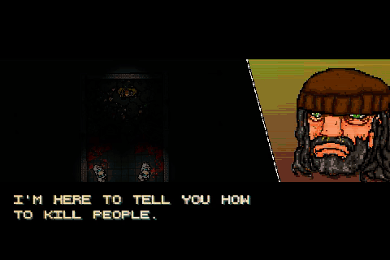

# Hotline Miami for Anbernic RG34XX (stock firmware)

A port of **Hotline Miami** (the GOG Linux build) to the Anbernic RG34XX / RG34XXSP running the **stock Anbernic firmware**. The game runs at a solid 60 fps with working controls and correct graphics.

The game is **not included**. You need your own copy of the GOG Linux version.



*Recorded on an RG34XXSP running stock firmware (screen capture, no audio). Full-quality MP4 on the [release page](../../releases).*

## What's in the box

The Linux build of Hotline Miami is a 32-bit x86 program that expects an X server, desktop OpenGL and NVIDIA Cg. None of those exist on the handheld, so this port puts together:

| Piece | What it does |
|---|---|
| [box86](https://github.com/ptitSeb/box86) 0.3.3 | Runs the i386 game binary on the device's ARM CPU |
| [gl4es](https://github.com/ptitSeb/gl4es) 1.1.5 | Translates desktop OpenGL to the Mali GPU's OpenGL ES 2 |
| NVIDIA Cg 3.1 runtime (i386) | Compiles the game's shaders |
| `shim/libX11.so.6` (`src/x11shim.c`) | A small fake Xlib + GLX that maps the game's X11 window onto a fullscreen SDL2/EGL surface |
| `shim/hm1gl.so` (`src/glspy.c`) | Fixes layered over gl4es for Mali driver quirks (see below) |
| `shim/padfix.so` (`src/padfix.c`) | Presents the built-in controls as an Xbox 360 pad, which is what the game's own pad support expects |
| `fbmode` (`src/fbmode.c`) | Saves and restores the framebuffer mode so the firmware menu doesn't come back black |

## Install

1. Download `hotlinemiami-rg34xx-stock-*.zip` from [Releases](../../releases).
2. Extract it into the `Roms/PORTS/` folder on the SD card that holds your ports. You should end up with:
   ```
   Roms/PORTS/Hotline Miami.sh
   Roms/PORTS/hotlinemiami/...
   Roms/PORTS/Imgs/Hotline Miami.png   (menu artwork)
   ```
3. Add the game files:
   - Get the GOG Linux installer (`gog_hotline_miami_2.0.0.4.sh` or similar) from your GOG library.
   - The installer is a shell script with a zip appended, so you can open it with [7-Zip](https://www.7-zip.org/) (`7z x -tzip gog_hotline_miami_*.sh`), or just run it on a Linux PC.
   - Copy **everything** in `data/noarch/game/` (`Hotline`, `HotlineMiami_GL.wad`, all the `.ogg` files, ...) into `Roms/PORTS/hotlinemiami/gamedata/`. It's about 520 MB.
4. Launch **Hotline Miami** from the Ports menu. The first boot takes a few seconds longer.

## Controls

The game's own gamepad support is used. The handheld appears to it as an Xbox 360 pad: buttons sit in Xbox positions, the sticks are the two analog sticks, the D-pad also drives the left stick (handy in menus), and L2/R2 are the analog triggers. The in-game controls screen shows what each button does.

To quit, pause (Start) and choose **Quit**.

Settings and saves live in `hotlinemiami/conf/HotlineMiami/`.

## Tested on

- RG34XXSP, stock Anbernic firmware.
- The other Allwinner H700 Anbernic devices on stock firmware (RG35XX Plus/H/SP, RG40XX, RG28XX...) use the same system and input device, so they will probably work. They are untested, and screen sizes other than 720x480 are not handled yet. Reports are welcome.
- Custom firmwares (muOS, Knulli, ROCKNIX) are not supported by this package.

## Troubleshooting

- **The game doesn't start.** Check `Roms/PORTS/hotlinemiami/log.txt`. The most common cause is game files missing from `gamedata/`.
- **The menu is black after quitting.** The launcher restores the menu's display mode on exit. If a crash skipped that, reboot the device.
- **Turn off pad emulation:** add `export PADFIX=0` near the top of `Hotline Miami.sh`. `PADFIX_SWAPAB=1` swaps A/B and X/Y. `PADFIX_GAIN` (default 8) sets stick sensitivity.

## Mali / gl4es issues this port works around

These are all handled in `src/glspy.c`, and each fix can be switched off with an environment variable:

- **Stale render targets (`HM1GL_FBOCLEAR`).** The game "clears" new off-screen surfaces with `glClear(0)`. Desktop drivers hand out zeroed textures; the Mali blob doesn't, so leftovers from menus showed up in levels. The fix does a real full clear the first time each texture is attached to an FBO.
- **Missing floors (`HM1GL_BAKEFIX`).** PhyreEngine binds framebuffer 0 right before the tile-baking draw. The floor tiles were drawn into the window and lost instead of into the floor surface. The fix redirects that draw back into the surface.
- **Opaque film grain (`HM1GL_NOISE_ALPHA`).** The full-screen noise overlay rendered opaque. Its alpha is baked into the texture at upload.
- **Missing extensions.** gl4es lacks `EXT_direct_state_access` program parameters, which Cg uses, so they are emulated. Pixel-unpack buffer objects (`HM1GL_PBO`) are also emulated.

`padfix` also hides the real joystick node from SDL and gives the game a translated one. The game reads `/dev/input/js0` directly and expects xpad axis ranges; the RG34XX reports its sticks on different axes at ±4096 and its triggers as buttons.

## Building

On Linux or WSL:

```sh
sudo apt install gcc-arm-linux-gnueabihf gcc-aarch64-linux-gnu
# put headers + the device's libSDL2 and the bundled gl4es into ./sysroot (see build.sh)
./build.sh
./package.sh /path/to/a/working/PORTS/hotlinemiami v1.0
```

## Credits and licenses

Port code (`src/`, `port/`, scripts): MIT, see [LICENSE](LICENSE). Bundled third-party runtime files: see [THIRD_PARTY.md](THIRD_PARTY.md).

Hotline Miami © Dennaton Games / Devolver Digital. This project is unofficial and not affiliated with them. Please buy the game.
